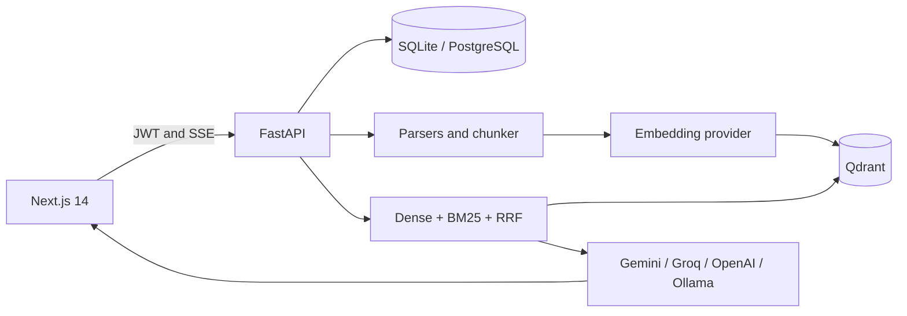

<div align="center">

# Personal RAG Assistant

### Ask your documents. Get answers you can verify.

Private document search with source-grounded answers, citations, and a clean workspace.

   

</div>

## What it does

- Upload PDF, DOCX, TXT, Markdown, CSV, XLSX, and PPTX files; ingest web pages and YouTube transcripts through the API.
- Parse and chunk documents with page/section metadata, deduplicate uploads by SHA-256, and track background ingestion status.
- Search with Qdrant dense vectors plus BM25 reciprocal-rank fusion; use local sentence-transformer or Gemini/OpenAI embeddings.
- Ask questions through a streaming chat interface with source citations and an excerpt drawer.
- Choose Gemini, Groq, OpenAI, or Ollama as the answer provider. An API key is needed for generated synthesis; without one, the API returns relevant excerpts.
- Manage private collections, chat history, and feedback with JWT email/password authentication.
- Run locally with SQLite and local Qdrant storage, or connect PostgreSQL, Redis, and Qdrant Cloud.

## Architecture



See [architecture details](docs/architecture.md), [API overview](docs/api_spec.md), and [evaluation report](docs/evaluation_report.md). There is no fabricated benchmark result; the sample benchmark needs an answer/context collection adapter before RAGAS can score it.

## Tech stack

| Area | Technology |
|---|---|
| API | Python 3.11, FastAPI, Pydantic v2, SQLAlchemy 2 async |
| Ingestion | PyMuPDF, python-docx, pandas, python-pptx, BeautifulSoup, YouTube Transcript API |
| Retrieval | Qdrant, sentence-transformers, BM25, reciprocal-rank fusion |
| Generation | Gemini, Groq, OpenAI, Ollama adapters |
| Web | Next.js 14 App Router, TypeScript, Tailwind CSS, Lucide |
| Operations | Docker Compose, GitHub Actions, Render, Vercel |

## Quick start

### Docker

```bash
cp .env.example .env
# Set a unique SECRET_KEY; add a Gemini key if you want generated answers.
docker compose -f infra/docker-compose.yml up --build
```

Open `http://localhost:3000`, register an account, upload a document, and ask a question. API docs are at `http://localhost:8000/docs` in development.

### Manual

Requirements: Python 3.11+, Node.js 20+, and optionally Docker for PostgreSQL/Redis/Qdrant.

```bash
python -m venv .venv
# Activate the environment, then:
pip install -r backend/requirements.txt
cd backend && uvicorn app.main:app --reload
```

In a second terminal:

```bash
cd frontend
npm install
npm run dev
```

The API defaults to SQLite and local Qdrant storage. Create an account in the web UI; provider keys may be set in `.env` or entered for the current browser session.

## Environment variables

| Variable | Purpose | Default |
|---|---|---|
| `SECRET_KEY` | JWT signing and API-key encryption | Development-only value; replace for production |
| `DATABASE_URL` | Async SQLAlchemy database URL | SQLite at `data/rag_assistant.db` |
| `QDRANT_URL`, `QDRANT_API_KEY` | Qdrant endpoint and optional key | Local persistent Qdrant |
| `REDIS_URL` | Shared rate-limit storage | Optional in-memory limiter |
| `GEMINI_API_KEY`, `GROQ_API_KEY`, `OPENAI_API_KEY` | Provider credentials | Unset |
| `DEFAULT_LLM_PROVIDER`, `DEFAULT_LLM_MODEL` | Default generator | Gemini / `gemini-3.8-flash` |
| `EMBEDDING_PROVIDER`, `EMBEDDING_MODEL_NAME` | Embedding backend | Local sentence-transformers |
| `CORS_ORIGINS` | Allowed browser origins (JSON array or comma-separated) | localhost:3000 |
| `NEXT_PUBLIC_API_URL` | API origin used by Next.js browser | `http://localhost:8000` |
| `MAX_UPLOAD_SIZE_MB` | Maximum upload size | 50 |

See [.env.example](.env.example) for the full configuration surface.

## API

The primary routes are described in [docs/api_spec.md](docs/api_spec.md). Health check: `/health`; readiness check: `/ready`; development OpenAPI docs: `/docs`.

## Evaluation

The current sample contains two reference questions in `backend/eval/test_dataset.json`. `docs/evaluation_report.md` explains what is still needed to produce valid RAGAS metrics. No evaluation scores are claimed until generated answers and retrieved contexts are measured.

## Status and roadmap

The current repository includes the email/password API, collections, document parsing/ingestion, hybrid retrieval, SSE chat, citations, feedback, basic usage counts, a responsive chat UI, Docker configuration, and CI workflow.

Next: Google OAuth, refresh-token revocation, multi-query/HyDE and cross-encoder wiring, durable job queue and ingestion progress UI, document tools (quiz/compare), richer analytics, accessibility and browser tests, Alembic migrations, Prometheus metrics, and measured RAGAS evaluation. See [deployment notes](DEPLOYMENT.md) for service setup; live deployment requires account authorization and credentials.

## Contributing

See [CONTRIBUTING.md](CONTRIBUTING.md). Commit messages follow Conventional Commits.

## License

MIT, see [LICENSE](LICENSE).
