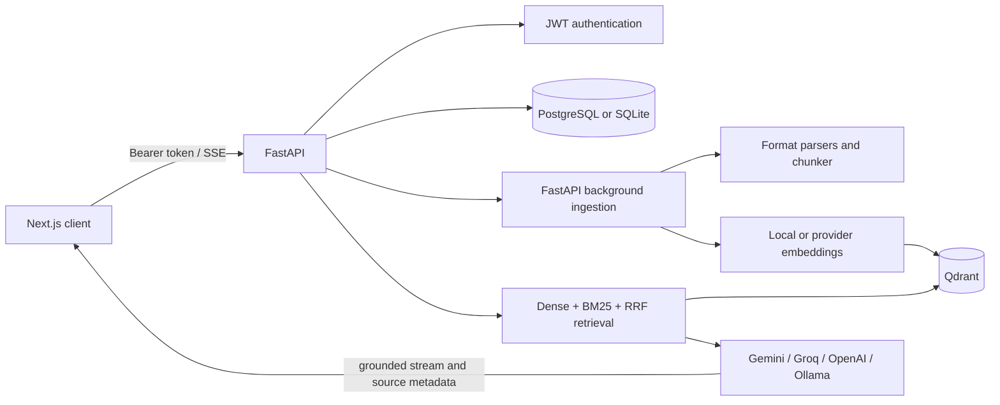

# Architecture

The API stores ownership, chat history, and chunk metadata in SQL. Qdrant stores vectors and their source payloads. BM25 is rebuilt from SQL-backed chunks when documents are ingested. Ingestion uses FastAPI background tasks, so a separate worker queue is not required for the local setup. The local Qdrant path is persistent; the in-memory fallback is a degraded mode and is not suitable for multi-process production use.
